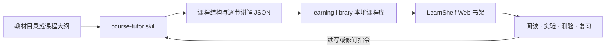

# LearnShelf（知页）

> 把教材目录变成一整本可阅读、可练习、可交互的本地课程书架。

[English](README.en.md) · [公开学习模式依据](references/public-learning-patterns.md) · [数据格式](references/course-format.md)

  

LearnShelf 是一个可供 Codex 和其他 agent 复用的技能包。用户给出课程或书籍目录后，agent 可以逐节生成分层讲解、图示、互动实验、理解检查和复习卡片，并将内容保存到独立的本地 Web 书架。学习内容不再散落在聊天记录里，而是按“书籍 → 章节 → 小节”长期管理。

**当前为早期半成品。界面、数据格式和 agent 工作流都可能变化，不保证稳定或完整；使用者需要自行检查生成内容并具备基本调试能力。**

## 它解决什么问题

- 从目录批量建立整本书的课程骨架，并可持续补写未完成小节。
- 依据知识类型组合文字、公式、SVG、步骤动画、参数实验、选择题和闪卡。
- 在浏览器中提供书架、章节目录、文章大纲、深浅主题和本地学习记录。
- 把课程文件保存在用户项目中，让不同 agent 通过同一份 `SKILL.md`、脚本和 JSON 格式继续工作。
- 不要求在网页里配置模型密钥；生成由当前 agent 完成，网页负责阅读和交互。



## 教学设计来源

本项目把 OpenAI 公开文档中可观察、可描述的产品行为转化为通用课程规则：

- [Study Mode](https://help.openai.com/en/articles/11780217-using-study-mode-in-chatgpt)：了解目标和基础，逐步引导，检查理解。
- [Intelligent UI](https://openai.com/index/gpt-6-for-everyone/)：根据问题选择文字、图形、按钮、表单、图表或交互体验。
- [Visualizations](https://learn.chatgpt.com/docs/visualizations)：用图表、示意图和可操作演示解释适合可视化的知识。

LearnShelf 是独立的开源实验项目，与 OpenAI 无隶属或背书关系。它不包含 ChatGPT 的私有提示词、内部 API、模型权重或原生组件实现；“参考公开模式”不等于复刻 ChatGPT。完整边界见 [公开学习模式](references/public-learning-patterns.md)。

## 快速开始

需要 Node.js 22 或更高版本，以及能够加载本地技能的 agent。Windows 是当前验证最充分的平台。

### 安装为 Codex 技能

直接克隆到技能目录：

```powershell
git clone https://github.com/lemcat-x/learnshelf.git "$env:USERPROFILE\.codex\skills\course-tutor"
```

也可以先克隆到任意目录，再运行安装脚本：

```powershell
git clone https://github.com/lemcat-x/learnshelf.git
cd learnshelf
powershell -NoProfile -ExecutionPolicy Bypass -File .\scripts\install-skill.ps1
```

安装脚本发现已有 `course-tutor` 时会停止，避免静默覆盖本地修改。升级前请先比较并备份旧版本。

### 让 agent 建课

在一个课程项目目录中告诉 agent：

```text
使用 $course-tutor，把我提供的教材目录导入本地书架，并先生成第 1 章供我确认风格。
```

技能会在该项目下创建 `learning-library/`。只有目录而没有教材正文时，生成的是围绕主题的原创通用讲解，不会声称复现原书。

### 直接体验示例课程

```powershell
node .\scripts\seed-demo.mjs --workspace .
powershell -NoProfile -ExecutionPolicy Bypass -File .\scripts\start-library.ps1 -Workspace .
```

其他平台可运行：

```bash
node scripts/seed-demo.mjs --workspace .
node scripts/course.mjs serve --workspace .
```

然后打开 `http://127.0.0.1:4317`。

## 给其他 agent 复用

兼容的 agent 至少需要能够读取文件、写入用户项目并执行 Node.js：

1. 加载仓库根目录的 `SKILL.md`。
2. 按需读取 `references/teaching-rules.md`、`course-format.md` 和 `interaction-components.md`。
3. 使用 `scripts/course.mjs` 创建课程、保存小节和校验课程库。
4. 将用户内容写入其项目的 `learning-library/`，不要写进技能安装目录。
5. 用打包好的 `assets/library-app/dist/` 启动本地书架；普通使用不需要安装前端依赖。

详细命令和写入边界以 `SKILL.md` 为准。当前没有通用云端队列、后台整书任务或自动付费模型 API 调用；“批量生成整本书”由运行该技能的 agent 在授权范围内分节保存并可恢复推进。

## 开发与验证

```powershell
cd assets\library-app
npm ci
npm run build
npm test
```

仓库提交构建后的 `dist/`，因此普通使用者只需 Node.js。开发依赖不会安装到用户课程项目中。

## 已知限制

- 目前以中文界面和 Windows 桌面工作流为主，跨平台启动脚本与国际化仍需完善。
- 目录只能提供主题和顺序，无法提供教材作者的论证、例题、页码和术语细节。
- 模型生成可能出现事实、推导、引用或题目答案错误；请复核重要内容。
- 自定义 HTML 实验仍是 alpha 能力，应检查键盘操作、边界值、主题和窄屏表现。
- 数据格式在 `0.x` 阶段可能发生不兼容变化。

欢迎通过 Issue 提供最小复现、课程 JSON 和浏览器/Node.js 版本。安全问题请遵循 [SECURITY.md](SECURITY.md)。

## License

[MIT](LICENSE)。第三方依赖与字体许可见 [THIRD_PARTY_NOTICES.md](THIRD_PARTY_NOTICES.md)。
